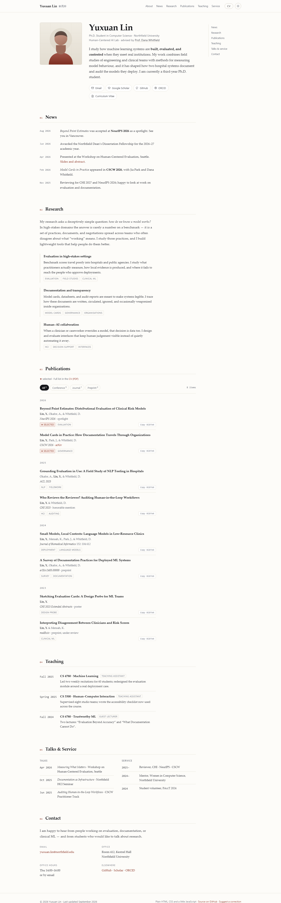

# Yuxuan Lin · 学术个人主页（GitHub Pages 模板）

一个可以直接挂在 GitHub Pages 上的学术个人主页：单页、无需构建、纯 HTML/CSS/一点点 JS。
包含研究简介、动态、论文列表（可筛选 / 一键复制 BibTeX）、教学、报告与服务、联系方式，以及一份可打印的 A4 简历。



<sub>手机端：[assets/preview-mobile.png](assets/preview-mobile.png) · 暗色模式：[assets/preview-dark.png](assets/preview-dark.png)</sub>

> ⚠️ 页面里的姓名、学校、导师、论文、邮箱全部是**虚构的示例数据**，上线前请全部替换。

---

## 目录

- [30 秒本地预览](#30-秒本地预览)
- [上线到 GitHub Pages](#上线到-github-pages)
- [上线后必做的 4 件事](#上线后必做的-4-件事)
- [替换成你自己的信息](#替换成你自己的信息)
- [文件结构](#文件结构)
- [进阶改动](#进阶改动)
- [常见问题](#常见问题)

---

## 30 秒本地预览

不装任何东西：**双击 `index.html`** 就能在浏览器里看。

想要更接近线上环境（相对路径、剪贴板 API 都正常）：

```powershell
cd github-academic-homepage
python -m http.server 8000
```

然后打开 <http://localhost:8000>。

---

## 上线到 GitHub Pages

关键点只有一个：**仓库名必须叫 `<你的用户名>.github.io`**，这样网址才是 `https://<你的用户名>.github.io/`。

下面三种方式任选一种，效果一样。

### 方式 A：不装软件，网页上传（最省事）

1. 打开 <https://github.com/new>，Repository name 填 `你的用户名.github.io`（例如 `xyzhou1231.github.io`），可见性选 **Public**，点 **Create repository**。
2. 在新仓库页面点 **uploading an existing file**（或 `Add file → Upload files`）。
3. 打开本文件夹，把**里面的所有文件和文件夹**拖进浏览器上传区（`index.html`、`assets` 文件夹等一起拖，保持层级）。
4. 下面 Commit changes 直接点 **Commit changes**。
5. 进入仓库 **Settings → Pages**：
   - Source 选 **Deploy from a branch**
   - Branch 选 **main**，目录选 **/ (root)**，点 **Save**
6. 等 1–2 分钟，访问 `https://你的用户名.github.io/`。

> 网页上传时 `.nojekyll` 这种点开头的文件可能选不中。**不影响本模板**（没有以下划线开头的目录，Jekyll 不会改坏任何东西），需要的话可以在仓库里 `Add file → Create new file`，文件名填 `.nojekyll` 再提交。

### 方式 B：GitHub Desktop（有图形界面）

1. 安装 [GitHub Desktop](https://desktop.github.com/)，登录账号。
2. `File → Add Local Repository`，选中本文件夹 → 提示不是 Git 仓库时点 **create a repository** → 创建。
3. 右上角 **Publish repository**：
   - Name 改成 `你的用户名.github.io`
   - **取消勾选** “Keep this code private”
4. Publish 之后按方式 A 的第 5 步打开 Pages（一般会自动开启）。

### 方式 C：Git 命令行

本机目前**没有安装 Git**，先装：

```powershell
winget install --id Git.Git -e
```

装完重开一个终端，然后：

```powershell
cd "C:\Users\121\Documents\deepseek-harness\default-workspace\github-academic-homepage"

git init -b main
git add .
git commit -m "Add personal homepage"

# 先在 GitHub 上创建空仓库：你的用户名.github.io
git remote add origin https://github.com/你的用户名/你的用户名.github.io.git
git push -u origin main
```

推送后到 **Settings → Pages** 选择 `main` 分支的 `/ (root)` 目录即可。

> 已经有其他仓库想用「项目页」（`https://用户名.github.io/仓库名/`）也行，但要把 `404.html` 里的 `/styles.css`、`/assets/...` 改成相对路径，否则子路径下会 404。

---

## 上线后必做的 4 件事

1. **改社交分享封面地址。** `index.html` 里 `og:image`、`twitter:image` 现在是 `assets/og-cover.png`（相对路径），部分平台不认，改成完整网址：
   `https://你的用户名.github.io/assets/og-cover.png`
   同时确认 `<link rel="canonical">` 已经是你的网址。
2. **换掉示例信息。** 见下一节。
3. **换成自己的照片。** 把照片存成 `assets/portrait.jpg`（正方形、建议 ≥ 600×600），再把 `index.html` 里 `` 改成 `portrait.jpg`，并更新 `alt`。
4. **更新 CV。** 修改 `cv.html` 后重新导出 PDF（见[进阶改动](#进阶改动)），覆盖 `assets/cv.pdf`。

---

## 替换成你自己的信息

先用一行命令把 GitHub 用户名批量替换掉（可选）：

```powershell
powershell -ExecutionPolicy Bypass -File .\personalize.ps1 -Username 你的用户名
```

> 如果不用自定义域名，这一步就够；其余内容按下表手工改。

| 要改的地方 | 现在的示例 | 说明 |
| --- | --- | --- |
| `index.html` `<title>`、`meta description`、`og:*` | Yuxuan Lin / 北原大学 | 搜索`Yuxuan Lin`逐个换 |
| 顶栏 `.brand-name` / `.brand-cn` | Yuxuan Lin / 林雨轩 | 中英文名 |
| 首屏 `h1`、`.hero-role` | 博士在读、Human-Centered AI Lab、导师 | 改成你的单位、实验室、导师 |
| `.hero-bio` | 三段研究自述 | **最重要的一段**：30 秒内说清你研究什么、用什么方法、在什么材料上工作 |
| `.hero-links` | Email / Scholar / GitHub / ORCID / CV | `user=XXXXXXXX`、ORCID 都要换成你自己的 |
| 页面底部 `<script type="application/ld+json">` | Person 结构化数据 | 影响搜索引擎收录，别漏 |
| `#news` | 5 条动态 | 最新的放最上面，`datetime` 用 `2026-08` 格式 |
| `#research` | 3 个研究方向 | 建议 3 个，每个一段话 + 3 个关键词 |
| `#publications` | 8 篇论文 | 每条 `<article class="pub" data-type="...">` |
| `#teaching`、`#service`、`#contact` | 助教、报告、服务、办公室 | 没有的段落可以整段删掉，记得同步删顶栏和目录里的链接 |
| `cv.html` / `cv.css` | 两页 A4 简历 | 与主页内容保持一致 |
| `README.md` | 本文件 | 可以整份替换掉 |

### 论文那部分怎么改

```html
<article class="pub" data-type="conference">
  <h3 class="pub-title"><a href="论文链接">论文标题</a></h3>
  <p class="pub-authors"><strong>你的姓, 名首字母.</strong>, 合作者, &amp; 导师</p>
  <p class="pub-venue"><em>会议/期刊名</em> · 补充说明</p>
  <div class="pub-tools">
    <span class="tag tag--selected"><span aria-hidden="true">★</span> selected</span>
    <span class="tag">主题标签</span>
    <button type="button" class="bib" data-bibtex="@inproceedings{...}">Copy BibTeX</button>
  </div>
</article>
```

- `data-type` 决定筛选归类，模板里用了 `conference` / `journal` / `preprint`。
- 年份靠外层 `<div class="pub-year" data-year-group>` 分组，新起一组就复制一个。
- `data-bibtex` 里放完整 BibTeX；注意属性值里的双引号要写成 `&quot;`，或者像模板这样直接用单引号包裹。
- **改完记得同步筛选按钮上的数字**（`All<sup>8</sup>` 之类）。数字不对不会报错，只是看起来不专业。

---

## 文件结构

```
github-academic-homepage/
├── index.html            # 主页（唯一需要大改的文件）
├── styles.css            # 设计系统：配色、排版、亮/暗主题、响应式
├── script.js             # 主题切换、论文筛选、BibTeX 复制、目录高亮
├── cv.html               # 可打印的 A4 简历
├── cv.css                # 简历版式与打印样式
├── 404.html              # GitHub Pages 的 404 页
├── .nojekyll             # 告诉 GitHub Pages 不要跑 Jekyll
├── personalize.ps1       # 批量替换 GitHub 用户名的可选脚本
├── assets/
│   ├── portrait.svg      # 头像占位图（换成 portrait.jpg）
│   ├── favicon.svg
│   ├── og-cover.svg/.png # 社交分享封面 1200×630
│   ├── cv.pdf            # 由 cv.html 导出的 PDF
│   ├── preview.png       # 桌面整页预览
│   ├── preview-hero.png  # 首屏预览（README / 分享用）
│   ├── preview-mobile.png
│   └── preview-dark.png
└── README.md
```

---

## 进阶改动

### 换配色 / 字体

打开 `styles.css` 开头的 `:root`，改这几个变量就够：

```css
--paper:  #fdfcf9;   /* 页面底色 */
--ink:    #17181c;   /* 正文颜色 */
--accent: #8a3324;   /* 强调色：链接、编号、星标 */
```

暗色模式在 `[data-theme="dark"]` 里对应改一份。字体改 `--serif` / `--sans` / `--mono` 三行。
建议保持「低饱和 + 一个强调色」，别超过两种颜色。

### 加一个新的论文类别

1. 复制一个筛选按钮：`<button class="chip" data-filter="workshop">Workshop<sup>2</sup></button>`
2. 论文上用 `data-type="workshop"`。
3. 数字同步。

### 想加中文 / 双语

本模板是英文主页（国际同行看得懂，GitHub 上也常见）。要做双语，两个方向：

- **省事版**：在 `#about` 开头加一段中文简介，其余保持英文。
- **完整版**：复制一份 `index.html` 命名 `index-zh.html`，把正文换成中文，两页互相加语言切换链接（记得同步导航和 `hreflang`）。

### 重新生成 CV 的 PDF

改完 `cv.html` 后，用 Chrome 无头模式导出（Windows）：

```powershell
& "C:\Program Files\Google\Chrome\Application\chrome.exe" `
  --headless=new --no-pdf-header-footer `
  --print-to-pdf="assets\cv.pdf" `
  "file:///C:/路径/index.html旁边的/cv.html"
```

或者直接在浏览器打开 `cv.html` → 点页面上的 **Print / Save as PDF** → 目标选「另存为 PDF」，记得勾上「背景图形」。

### 重新生成预览图 / OG 封面

```powershell
# 整页预览（截图高度按内容调整，再裁掉底部空白）
& "C:\Program Files\Google\Chrome\Application\chrome.exe" --headless=new --disable-gpu --hide-scrollbars `
  --window-size=1440,3800 --screenshot="assets\preview.png" "file:///C:/路径/index.html"

# 社交封面：先把 assets\og-cover.svg 在浏览器打开，截 1200×630 存成 og-cover.png
```

### 绑定自己的域名

1. 域名 DNS 加一条 `CNAME` 记录指向 `你的用户名.github.io`。
2. 仓库 Settings → Pages → Custom domain 填入域名。
3. 仓库根目录会自动生成 `CNAME` 文件，别删。
4. 换域名后记得回来改 `canonical` 和 `og:image`。

---

## 常见问题

**打开是 404？**
仓库名必须**完全等于** `你的用户名.github.io`（大小写也要一致）。创建的是项目页时，网址是 `https://用户名.github.io/仓库名/`。

**页面没样式、图标不显示？**
多半是在子路径（项目页）下用了 `/` 开头的绝对路径。检查 `index.html` 里都是相对路径（`styles.css`、`assets/...`）。

**改了内容线上没变？**
Pages 构建有 1–2 分钟延迟，先看仓库 **Actions / Environments** 里的部署状态；再用 `Ctrl + F5` 强制刷新。

**仓库可以是私有的吗？**
Pages 对私有仓库要 GitHub Pro；免费账号请保持 Public。

**`404.html` 在子路径下不生效？**
它用的是 `/styles.css` 这类根路径，只适合 `用户名.github.io` 这种根站点。项目页请改成相对路径。

**不想用中文注释 / 想全英文？**
`README.md` 整份换掉即可，代码里注释是英文的。

---

## 说明

- 站内所有人物、机构、会议、论文、期刊、邮箱与地址均为**演示数据**，不对应任何真实个人或单位。
- 上线前逐条核对论文信息，避免把示例内容带进正式简历。
- 页面不加载任何外部字体、统计脚本或 CDN，离线可用，也没有隐私与合规负担。
